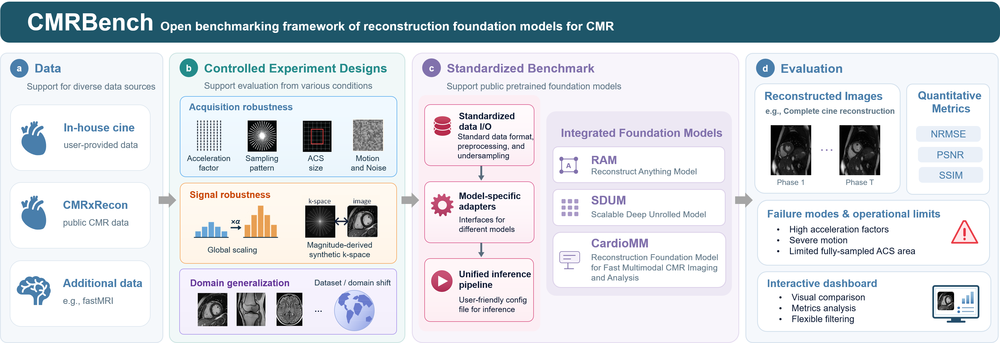

# MRBench: Benchmarking Foundation Models for MRI Reconstruction

MRBench is a benchmark for evaluating foundation models for MRI reconstruction 
across acquisition conditions, signal fidelities, and imaging domains. 
It supports systematic comparisons of reconstruction quality.

This public release contains the interactive dashboard. 
The complete Python benchmarking framework is being prepared for public release.

## Framework Overview



## Interactive Dashboard

**[Explore the MRBench Dashboard →](https://lab-midas.github.io/MRBench/)**

Explore the framework, dataset and model information, experiment designs, available
results, and evaluation metrics and protocol. Published results currently cover
acceleration factor and sampling pattern; additional experiment results are planned.

## Repository Structure

```text
website/                Interactive dashboard source
  assets/               Original framework figure and website assets
  data/                 Published metrics, audit and resource metadata
  docs/                 Scientific protocol and maintenance documentation
  experiments/          Experiment views and comparison logic
.github/workflows/      GitHub Pages deployment and automated validation
```

## Models and Data

The benchmark integrates [RAM](https://github.com/matthieutrs/ram),
[SDUM](https://github.com/NVIDIA-Medtech/NV-Raw2insights-MRI) and
[CardioMM](https://github.com/wangziblake/CardioMM_MMCMR-427K). Models, pretrained
weights and external datasets are credited to their original authors and providers.
The dashboard links to the original papers and code and identifies evaluated variants.

Published results use the in-house cardiac cine cohort. Dataset pages also introduce
CMRxRecon and fastMRI; benchmark results for these external datasets are not included
in this release. Local preview and validation instructions are in [website/README.md](website/README.md).
