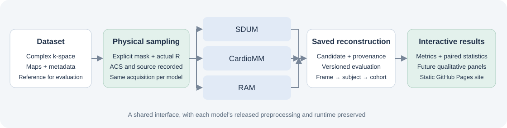

# CMRBench

CMRBench provides a shared way to ask how pretrained reconstruction models
behave when cardiac MRI acquisition conditions change. The same measurements
and physical sampling mask can be passed to SDUM, CardioMM and RAM, while each
model keeps its own released preprocessing and runtime. Results can then be
evaluated with one versioned protocol and explored in an interactive dashboard.

This is an **early research snapshot prepared for abstract submission**.
It includes the generic reconstruction interface, three model integrations,
sampling tools, simulation scripts and a frozen main experiment. Additional
robustness and cross-dataset experiments will be added as their results become
available. An available adapter or simulation does not imply a completed cohort
evaluation.



## Try the interface in a few minutes

Start with a small synthetic cine. This example exercises the same dataset,
sampling and reconstruction entry point as the real experiments, using a
zero-filled baseline. It needs no patient data, GPU, model weights or external
model repository. Use Python 3.10 or newer for the core package.

```bash
python -m pip install -e .
python examples/make_toy_data.py
python -m cmrbench.reconstruct --config examples/toy_reconstruction.yaml
python -m cmrbench.evaluate --reconstruction-dir outputs/toy_reconstruction
```

Run these commands from the repository root. The reconstruction command saves
arrays, configuration and provenance; the evaluation command reads those
outputs and writes Metrics v2, QC figures and a cine animation. Keeping these
steps separate also lets you evaluate an existing reconstruction without
running its model again. See [the walkthrough](docs/getting_started.md) for
output locations and for moving from the toy example to your own data.

To run RAM on prepared cardiac cine, edit the data paths in
[`examples/cine_ram.yaml`](examples/cine_ram.yaml), make CMRBench importable in your
RAM runtime, then call the same entry point:

```bash
python -m cmrbench.reconstruct --config examples/cine_ram.yaml
```

The model section references a small model YAML. Replacing that reference with
`../configs/models/sdum_base.yaml` or `../configs/models/cardiomm.yaml` selects
another adapter; first configure that model's assets and acquisition metadata.
The core installation alone does not install all three model runtimes. Use
separate environments and follow [the model setup guide](docs/models.md).

## Bring your data into a common representation

At the dataset boundary, a sample contains complex multi-coil k-space, optional
reference images, optional coil sensitivity maps, and acquisition metadata.
Every model ultimately receives an explicit physical mask alongside its actual
undersampled measurements. The reference is used for evaluation, not supplied
to the reconstruction model as a target.

| Array | Canonical shape | Meaning |
| --- | --- | --- |
| K-space | `[S,T,Kx,Ky,C]` | Slice, cardiac phase, two spatial frequency axes, coil |
| Sampling mask | `[S,T,Kx,Ky]` | Binary physical sampling support, shared across coils |
| Reference | `[S,T,X,Y]` | Optional image target for evaluation |
| Sensitivity maps | `[S,1,X,Y,C]` or `[S,T,X,Y,C]` | Complex maps; a singleton time axis broadcasts across phases |

For the current cardiac reader, X/Kx is the frequency-encoding axis and Y/Ky
is the phase-encoding axis. The reader loads prepared complex coil-combined
images and sensitivity maps, forms coil images and applies a centered FFT.
**This produces constructed benchmark k-space, not raw scanner k-space.**
The exact filenames and a minimal manifest are explained in
[the data guide](docs/data.md).

A fastMRI multi-coil reader is also included. It maps selected static slices
into the same representation with `T=1`; this input capability does not imply
a completed brain/knee cohort benchmark. CMRxRecon integration and additional
cross-dataset evaluations remain future work. New dataset readers can use the
same interface without changing the reconstruction models.

## What each model needs

The shared interface keeps input handling consistent, but the models make
different assumptions. Their adapters preserve those differences explicitly.

| Model | Inputs beyond k-space and mask | Current behavior |
| --- | --- | --- |
| RAM, DeepInv backend | Provided or acquired-ACS-estimated sensitivity maps; DeepInv 0.3.5 runtime | Framewise complex reconstruction using a multi-coil forward operator |
| RAM, pinned GitHub backend | Sensitivity maps and pinned external RAM source | Alternative historical backend; not the main table's backend |
| SDUM Small/Base/Large | Released source, checkpoint/config, acquisition category and sampling conditioning; usable acquired calibration support | Temporal windows; estimates maps internally; returns RSS magnitude |
| CardioMM | Released source, checkpoint, local CLIP assets and six acquisition metadata fields; calibration and sampling conditioning | Framewise reconstruction; estimates maps internally |
| Zero-filled baseline | Sensitivity maps | Centered inverse FFT and sensitivity-weighted coil combination |

CardioMM needs `lifespan`, `field_strength`, `vendor`, `scanner`, `modality` and
`view`. Fill these with the acquisition's actual values. SDUM Base/Large also
use acquisition and sampling labels. Physical sampling and model conditioning
are recorded separately: an unsupported pattern must not be silently renamed
to a supported one. See [model setup and compatibility](docs/models.md).

## Explore acquisition changes

CMRBench separates the physical sampler from the model. This is essential when
asking how the same model behaves under a sampling shift, or comparing models
on the same measurements.

| Sampling family | Available selectors | Notes |
| --- | --- | --- |
| Uniform Cartesian | `uniform`: canonical, SDUM or CardioMM | Fixed pattern; centering and ACS policy are explicit |
| Spatiotemporal Cartesian | `kt_uniform`, `kt_gaussian`: SDUM or CardioMM | Released implementations are selected explicitly |
| Pseudo-radial | `kt_radial`: SDUM or CardioMM; `radial`: CardioMM | Rasterized Cartesian support, not a non-Cartesian NUFFT acquisition |
| Static Cartesian | `random`: SDUM or CardioMM; `equispaced`: SDUM | Suitable for static inputs subject to model compatibility |
| VISTA | `vista`: precomputed or CMRBench port | Model conditioning/calibration compatibility must be checked |
| Supplied masks | `external_mask` | Validate and preserve the actual mask and provenance |

The package also exposes an independently implemented `RandomCartesianSampling`
class for programmatic use; it is not a registered YAML selector in this
snapshot. A registered sampler is not a promise that every model supports it.

Always retain **nominal R and actual R**. Central calibration support and the
released pseudo-radial rasterization can materially change the acquired sample
fraction. The frozen main experiment uses the CardioMM implementations of the
three k-t families, nominal R=8/16/24, ACS width 20 and seed 1.

## Read the results

The [dashboard](website/index.html) contains 1,755 audited subject-level results:
65 subjects, three models, three sampling families and three nominal
accelerations. Models are SDUM Base, CardioMM and RAM DeepInv. Each of the 27
condition groups includes the same 65 subjects, and the cross-model physical
mask audit passed. CSV values are retained from the finalized source; subject
identifiers are replaced with release-specific case IDs.

Serve the static site locally:

```bash
python -m http.server 8000 --directory website
```

Open `http://localhost:8000`. The site supports condition filters, subject
distributions, acceleration trends, paired model differences and downloadable
metrics. Only acceleration and k-t sampling results are included. Qualitative
evaluation and other test results remain empty placeholders. See
[the dashboard guide](website/README.md) for deployment and adding experiments.

Primary Metrics v2 normalize each complete subject image source independently
by its magnitude p99.5, without clipping, then calculate frame metrics. The
subject endpoint is the equal mean across frames, and cohort summaries give
equal weight to subjects. Raw-amplitude Metrics v1 remain a separate diagnostic.
See [the evaluation protocol](docs/evaluation_protocol.md).

No existing result images or cine animations are distributed in this release.
When qualitative panels are added, their physical masks and display conventions
will be recorded. Runtime values are
reported descriptively; hardware and timing scope must be matched before making
efficiency claims.

## Reproduce or extend an experiment

The simulation tools include complex Gaussian measurement noise, cardiac
mistriggering, a respiratory-translation surrogate, global input scaling and
magnitude-derived synthetic k-space. The [experiment guide](experiments/README.md)
explains the settings, what is held fixed, and the evidence currently shipped.
Slurm helpers are study-specific templates; they preserve the original frozen
66-subject task schema while the final published main table contains 65 eligible
subjects. See their README before creating or submitting manifests.

For new datasets, models or samplers, register one component and keep the
canonical interfaces intact. For new dashboard experiments, add a manifest entry
and a versioned data file. [The extension guide](docs/extending.md) describes
these boundaries and the result schema.

## Release status and attribution

Authors, affiliations and the first-party code license will be finalized before
the formal release. A project-wide license has not yet been assigned. Third-party
components retain their own terms and notices, including the VISTA research-use
notice and NVIDIA/MONAI sampling attribution. The pinned CardioMM sampling
adaptation has an academic-use statement but no standard license in the audited
source; redistribution terms need resolution before uploading that component.
See [third-party notices](THIRD_PARTY_NOTICES.md) and
[release scope](docs/release_scope.md).

This snapshot excludes patient arrays, model weights, external model repositories,
private result linkage tables, development histories and site-specific IDE files.
It can be maintained together with the dashboard in one public CMRBench repo.
